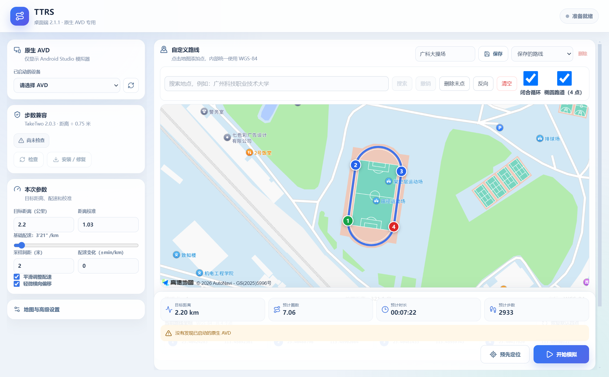

# TTRS · 软件分发与使用教程

TTRS（TakeTwo Route Simulator）提供 Windows 定位路线测试程序。本仓库发布可运行软件、教程及更新说明，**程序源码工程不公开**。

**本软件不仅仅适用于Taketwo，步道乐跑和运动世界等等乐跑软件都通用（还没做过测试）。

## 选哪个版本？

| 渠道 | 版本 | 模拟器 | 适合谁 |
| --- | --- | --- | --- |
| **正式版，优先下载** | **2.0 系列（内部版本 2.0.1）** | **雷电优先，也保留原生 AVD** | 希望安装配置简单的用户 |
| **测试版 / Pre-release** | **2.1.1** | **仅 Android Studio 原生 AVD** | 已配置 AVD，希望测试地图重载、停止清空等改动的用户 |

2.0 正式版使用维护者指定的既有 `dist/win-unpacked` 程序，内部版本号是 **2.0.1**，并非重新改成了 2.0.0。本次没有修改这份程序的业务逻辑。

维护者最新反馈：2.0 系列配合指定的步数兼容 v2 APK，在雷电环境中也可以记录步数。不同雷电版本都适用（9和14）；这不表示环境检测问题已被修复。

## 正式版下载：2.0 系列 / 2.0.1

- **[正式版 Release](https://github.com/linmiao09/GKD_TakeTwo_monipao/releases/tag/v2.0.1)** · [直接下载程序 ZIP](https://github.com/linmiao09/GKD_TakeTwo_monipao/releases/download/v2.0.1/TTRS-2.0.1-Windows.zip)
- **[单独下载配套 APK](https://github.com/linmiao09/GKD_TakeTwo_monipao/releases/download/v2.0.1/app-taketwo2.0.3-stepfix-v2-signed.apk)**
- **[雷电版安装与使用教程](docs/雷电正式版教程.md)**

完整解压 ZIP 后打开 `软件/TTRS.exe`，先按教程选择“雷电”，填写“雷电安装目录”和“实例索引”。保留 EXE 旁的所有运行文件。APK 可以拖进雷电窗口安装，程序包内也保留同一份 APK。

首次需要安装雷电；**不要求安装 Android Studio、Node.js、npm 或开发源码**。雷电从[官方网站](https://www.ldmnq.com/)获取。

## 测试版下载：2.1.1 / 原生 AVD

- **[测试版 Release](https://github.com/linmiao09/GKD_TakeTwo_monipao/releases/tag/v2.1.1)** · [直接下载程序 ZIP](https://github.com/linmiao09/GKD_TakeTwo_monipao/releases/download/v2.1.1/TTRS-2.1.1-Windows.zip)
- [单独下载配套 APK](https://github.com/linmiao09/GKD_TakeTwo_monipao/releases/download/v2.1.1/app-taketwo2.0.3-stepfix-v2-signed.apk)
- **[Android Studio / AVD 测试版教程](docs/使用教程.md)**

2.1.1 仅支持原生 AVD，不支持雷电。教程基线：Pixel 3 + Android 9 / API 28 + Google APIs x86_64。该版提供“应用并重新加载地图”和手动停止后清空实时面板等改动。



上图是 **2.1.1 测试版**，雷电正式版的左侧模式选择与配置项不同。

## 配套 APK 与步数

两版提供的 `app-taketwo2.0.3-stepfix-v2-signed.apk` 内容相同。它是 **TakeTwo 步数兼容 v2 补丁版**，不是原版 APK，也不是旧 v1 补丁。文件名中的 2.0.3 与 TTRS 桌面版本号是不同标识。

在没有可用计步传感器步数时，该兼容 APK 按实际距离除以 0.75 米回退保存步数。TTRS 面板的估算值不等于目标应用最终保存结果。

APK SHA-256：

```text
2dc2f8a3744e3eeed01e445061ffb149aa50bcfff18be8e04d9e1b206f34b5e4
```

安装若遇签名冲突，需要先处理需保留的数据，再决定是否手动卸载原应用。**卸载会清除模拟器中该应用的本地数据。**

## 下载时注意

- GitHub 的 **Latest** 指向正式版；2.1.1 标记 **Pre-release**，不能只按数字大小选版本。
- 下载各 Release 的 `TTRS-版本-Windows.zip` 与需要的 APK。
- **Source code (zip / tar.gz)** 是 GitHub 自动提供的文档仓库快照，不是可运行程序，也不含 TTRS 源码工程。
- 两个版本放在不同目录，切换前退出另一版。两版可能使用同一 Windows 用户的已有配置，切换后核对模式、目录和路线。
- 高德在线地图需要用户自己的 Web 端（JS API）Key 和配套安全密钥。

## 文档、许可与反馈

- [雷电正式版教程](docs/雷电正式版教程.md)
- [AVD 测试版教程](docs/使用教程.md)
- [更新记录](CHANGELOG.md)
- [分发及第三方组件说明](NOTICE.txt)

本项目用于有权开展的开发、技术交流与兼容性测试，请遵守相关应用、服务及机构规则。第三方组件与 APK 的权利、使用和再分发条件独立适用；本仓库说明不构成额外授权。

问题反馈：[提交 Issue](https://github.com/linmiao09/GKD_TakeTwo_monipao/issues)，或联系 [miaomiaolinmiao@gmail.com](mailto:miaomiaolinmiao@gmail.com)。请提供 TTRS 和模拟器版本、错误文字及遮挡隐私后的截图，勿提供密码、地图密钥或认证文件。
